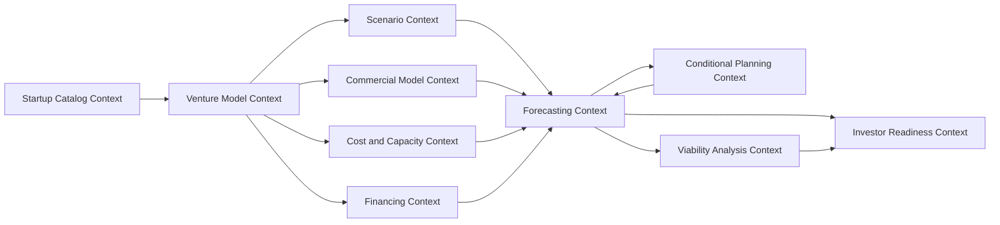

# Domain Map

This document defines the bounded contexts for V1. Terms are defined in [Ubiquitous Language](03-ubiquitous-language.md). Cross-context invariants are defined in [Domain Invariants](04-domain-invariants.md).

## Context Diagram

## Startup Catalog Context

Responsibility:

Track the startup boundary for a user or workspace.

Owns:

- Startup identity
- Startup membership reference
- Startup lifecycle state

Does not own:

- Forecast assumptions
- Financial statements
- Cross-startup consolidation

Important rule:

The catalog may list many startups, but each Startup Model belongs to exactly one startup and cannot be combined with another startup in V1.

## Venture Model Context

Responsibility:

Define the Startup Model, forecast horizon, reporting currency, opening facts, assumption set, and approved Model Versions.

Owns:

- Startup Model
- Model Version
- Forecast Horizon
- Reporting Currency
- Opening Fact
- Assumption Set

Publishes:

- Approved model inputs
- Model version identity
- Startup boundary

## Commercial Model Context

Responsibility:

Define customers, acquisition, conversion, retention, revenue streams, pricing, billing, recognition, and collections.

Owns:

- Revenue Stream
- Pricing Plan
- Customer Segment
- Acquisition Assumption
- Conversion Assumption
- Churn Assumption
- Retention Assumption
- Expansion Assumption
- Billing Policy
- Collection Policy
- Revenue Recognition Policy

## Cost and Capacity Context

Responsibility:

Define expenses, workforce plans, capital expenditure, depreciation, payment timing, and metric allocation policies.

Owns:

- Expense
- Expense Classification
- Accounting Treatment
- Business Function
- Economic Purpose Allocation
- Cost Behaviour
- Metric Allocation Policy
- Workforce Position
- Compensation Plan
- Capital Purchase
- Depreciation Policy
- Supplier Payment Policy

Detailed rules live in [Expense and Allocation Model](05-expense-and-allocation-model.md).

## Financing Context

Responsibility:

Define planned financing events, debt, repayments, grants, and minimum cash policies.

Owns:

- Financing Event
- Debt Facility
- Repayment Schedule
- Minimum Cash Policy
- Funding Target

Does not own:

- Cap table
- Valuation
- SAFE conversion
- Convertible-note conversion

## Scenario Context

Responsibility:

Define scenario identity, inheritance, overrides, scenario families, and comparison compatibility.

Owns:

- Scenario
- Scenario Override
- Scenario Family
- Comparison Definition

Detailed rules live in [Scenarios and Conditional Planning](08-scenarios-and-conditional-planning.md).

## Conditional Planning Context

Responsibility:

Define milestone conditions, actions, triggering policies, priority, and conflict resolution.

Owns:

- Conditional Plan
- Condition
- Action
- Trigger Policy
- Effective Timing Policy
- Action Priority
- Conflict Resolution Result

Detailed rules live in [Scenarios and Conditional Planning](08-scenarios-and-conditional-planning.md).

## Forecasting Context

Responsibility:

Produce deterministic monthly operational and financial results from an approved Model Version and Scenario.

Owns:

- Forecast Run
- Period Result
- Customer Schedule
- Revenue Schedule
- Expense Schedule
- Financing Schedule
- Statement Set
- Calculation Lineage

Detailed rules live in [Forecast Engine](07-forecast-engine.md).

## Viability Analysis Context

Responsibility:

Calculate runway, break-even, funding requirement, unit economics, sensitivity, and risk indicators.

Owns:

- Runway Result
- Break-Even Result
- Unit Economics Result
- Funding Requirement Result
- Sensitivity Result
- Viability Warning

Metric formulas and eligibility rules live in [Metric Policies](06-metric-policies.md).

## Investor Readiness Context

Responsibility:

Assess whether a model is complete, consistent, scenario-aware, explainable, and credible enough for investor discussion.

Owns:

- Readiness Assessment
- Readiness Policy
- Readiness Finding
- Investor Summary

Does not own:

- Valuation
- Investment recommendation
- Legal advice
